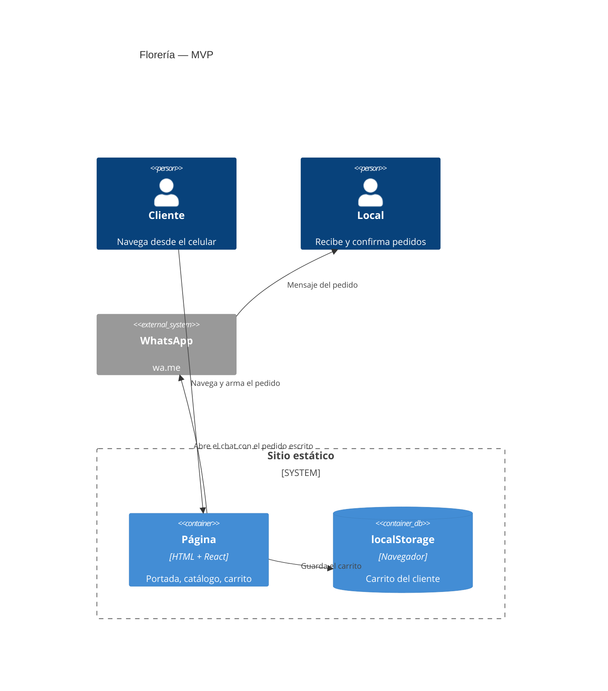

# 03 · Arquitectura

Versión 0.1 · 2026-10-15

## Vista general

No hay backend. `next build` lee `content/*.json`, lo valida con Zod y genera HTML estático en `out/`. En el navegador solo se hidratan las partes interactivas: carruseles y carrito.

## Flujo de datos

1. **Build.** `src/lib/content.ts` importa los JSON y llama a `validateContent()` (`src/lib/validate.ts`). Esa función valida cada archivo contra su schema, chequea que cada producto apunte a una categoría existente y que no haya ids repetidos, y devuelve el catálogo ordenado sin categorías vacías ni productos no disponibles.
2. **Render.** `src/app/page.tsx` (Server Component) arma la página con ese contenido.
3. **Cliente.** `CartProvider` recupera el carrito de `localStorage` después del primer render (para no romper la hidratación) y lo guarda en cada cambio. `CartDialog` arma el mensaje con `buildOrderMessage()` y abre `wa.me`.

## Componentes

**Servidor (sin JS en el cliente):** `SiteHeader`, `HeroSlider`, `CategorySection`, `ProductCard`, `HowToOrder`, `VisitUs`.

**Cliente:**

- `Carousel`: un solo componente con dos variantes. `hero` muestra un slide por vez con puntos, loop y autoplay. `mini` muestra varios con flechas. Usa `scroll-snap` nativo, así que el gesto de deslizar lo resuelve el navegador y sin JS sigue funcionando como fila deslizable. Recibe los slides como `children`, lo que permite que los slides sean Server Components.
- `CartProvider`, `CartButton`, `AddToCartButton`, `CartDialog`. El diálogo usa `<dialog>` nativo: trae foco atrapado, Escape y fondo inerte sin código propio.

**Lógica pura (testeable sin React):** `src/lib/cart.ts` (reducer y lectura segura del carrito guardado), `src/lib/whatsapp.ts` (mensaje y URL), `src/lib/format.ts` (precios en ARS).

## Relación con la plataforma de páginas personalizables

Esta app vive en `apps/floreria` como sitio independiente. No se armó todavía un paquete `core` compartido porque es la primera vertical con código en este repo. Candidatos a mover a `core` cuando haya una segunda vertical: `Carousel`, el patrón de contenido JSON validado con Zod, el carrito y los tokens de `globals.css`.

## Diseño

Tokens en `src/app/globals.css`. Violeta jacarandá para el acento, verde tallo para acciones y bloques sólidos, blanco frío de fondo. Tipografías Gloock (títulos) y Figtree (texto), autoalojadas vía Fontsource para no depender de Google Fonts en el build. El nombre de cada tipo de flor en tamaño grande es el elemento visual principal; su tamaño se limita al ancho de la columna con container queries para que nombres largos no pisen el carrusel.

## Rendimiento

Objetivos (no medidos todavía, son la vara contra la cual medir el primer deploy):

- LCP < 2,5 s en mobile 4G simulado (Lighthouse).
- CLS < 0,1. Todas las imágenes declaran ancho y alto.
- JS de la página lo más bajo posible: solo carrusel y carrito son componentes de cliente.

Qué medir y con qué, cuando haya fotos reales:

- Lighthouse en modo mobile sobre el deploy: LCP y peso total de imágenes.
- Peso de `out/_next/static/chunks` después de `npm run build`, para detectar si una dependencia nueva infla el JS.

Lo que más va a mover el LCP es el peso de la primera foto del hero. Por eso `next/image` está en modo `unoptimized` (export estático) y las fotos tienen que subirse ya redimensionadas: ver [05 · Guía de contenido](05-guia-de-contenido.md).
