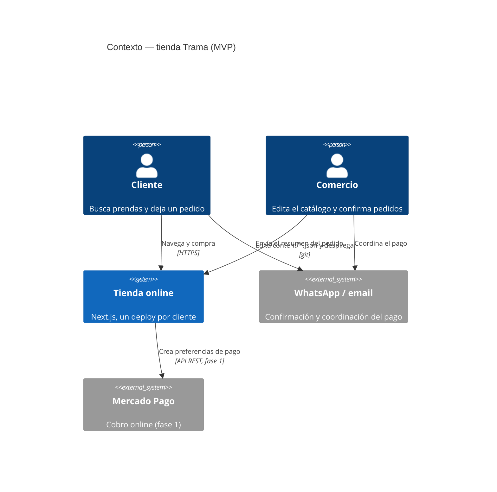
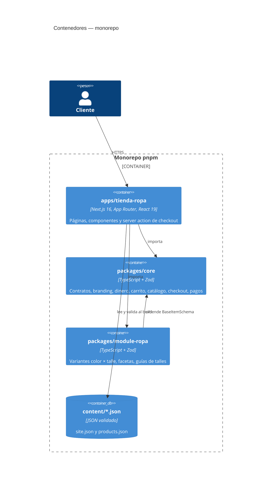
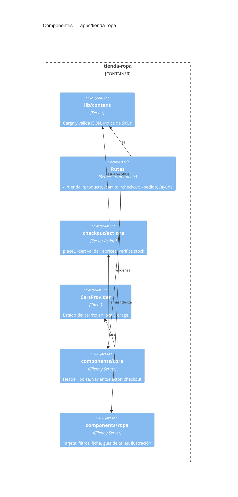
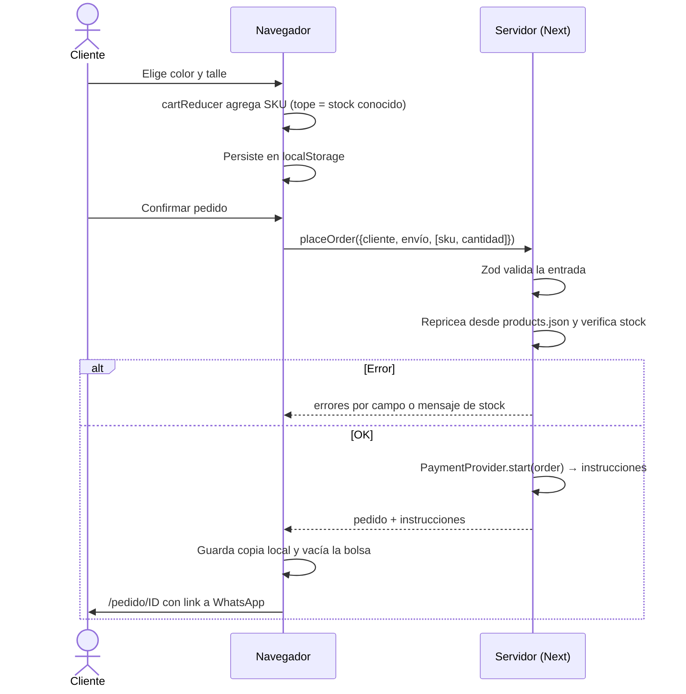

# 03 — Arquitectura

**Versión:** 0.1 · **Fecha:** 2026-10-15

## Contexto

## Contenedores

## Componentes de la app

## Qué va en cada lugar

**`packages/core`** no conoce talles ni colores. Define el contrato mínimo de un ítem vendible (`BaseItemSchema`), el carrito por SKU (`CartLine.meta` es un mapa libre para lo que cada vertical quiera mostrar), el checkout puro (`buildOrder`) y la interfaz de pagos (`PaymentProvider`). No depende de React: se testea con Vitest en Node y se podría reusar desde un backend.

**`packages/module-ropa`** extiende el contrato con colores, talles y variantes, y aporta la lógica de filtrado que solo tiene sentido en indumentaria.

**`apps/tienda-ropa`** arma la tienda. Los componentes están separados en `components/core` (reutilizables: header, bolsa, `VariantSelector`, checkout) y `components/ropa` (tarjeta, filtros, ficha). Hoy viven en la app y no en un paquete porque hay un solo consumidor; se extraen a `packages/ui` cuando exista el segundo vertical (ver decisión D5).

## Flujo de compra

## Decisiones

**D1. Monorepo con `core` + un módulo por vertical.** Se mantiene lo definido antes de escribir código. Permite sumar Gastronomía o Juegos de mesa sin tocar el núcleo, y obliga a que la lógica genérica no se contamine con conceptos de ropa.

**D2. Contenido en JSON validado con Zod, sin base de datos.** No hay clientes que justifiquen un panel ni una DB. El JSON se edita a mano, se versiona en git y se valida en el build. Trade-off: cada cambio de stock requiere un deploy. Se revisa en la fase 1.

**D3. Los paquetes se publican como TypeScript fuente.** Next los compila con `transpilePackages`. Evita un paso de build por paquete. Trade-off: los paquetes no se pueden consumir fuera del monorepo sin compilarlos.

**D4. El servidor recalcula todo en el checkout.** El navegador solo manda SKU y cantidad. Precio, nombre y stock salen del catálogo. Es lo que permitirá agregar Mercado Pago sin cambiar el contrato.

**D5. `VariantSelector` en core.** Talle y color son variantes de ropa, pero el selector es genérico (opciones, disponibilidad, estilo botón o swatch). Gastronomía (tamaño) y juegos (edición) lo reutilizan.

**D6. Filtros como links, no como estado de cliente.** Funcionan sin JavaScript, se comparten y el servidor renderiza el resultado. El único control que requiere JS es el `<select>` de orden.

**D7. Ilustraciones SVG en lugar de fotos de stock.** La tienda de ejemplo no tiene fotografía propia; usar fotos de bancos sería engañoso para una marca. Cada color se dibuja con su hex. El schema ya admite fotos por color; cuando existen, reemplazan la ilustración.

**D8. Sin cuentas de usuario.** El checkout como invitado es el estándar recomendado y reduce el alcance del MVP.

**D9. CSS plano con custom properties, sin framework.** El branding se inyecta como variables desde `site.json`; un framework de utilidades no aporta en un sitio de este tamaño y agrega una dependencia.

## Rendimiento

Siguiendo el criterio del proyecto: no se optimiza sin medición.

**Medido** (2026-10-15, build de producción servido con `next start` en local, Chromium headless, sin caché, una carga por ruta, Resource Timing del navegador):

| Ruta | Scripts | JS transferido | JS descomprimido |
| --- | --- | --- | --- |
| `/` | 7 | 171,5 KB | 570 KB |
| `/tienda` | 8 | 172,5 KB | 572 KB |
| `/producto/[slug]` | 8 | 175,3 KB | 579 KB |
| `/checkout` | 8 | 174,6 KB | 578 KB |

Lectura: la diferencia entre páginas es de 1 a 4 KB; casi todo el peso es el runtime de Next y React, compartido. El código propio es una fracción chica. Optimizar componentes propios hoy movería poco.

**No medido todavía** (requiere un deploy real): LCP, INP y CLS en dispositivos y redes reales. Se miden con Lighthouse y Web Vitals sobre el primer deploy (ver roadmap).

**Supuestos a verificar:**
- La ficha de producto se renderiza en cada request porque lee `?color=` en el servidor. Si el TTFB de esa ruta resulta alto, la alternativa es prerenderizarla y resolver el color en el cliente, a costa de un cambio visible de color al cargar links con `?color=`. No se cambia sin datos.
- La búsqueda y los filtros recorren el catálogo completo en cada request. Con 18 productos es irrelevante; se revisa si el catálogo pasa de algunos miles de productos.
